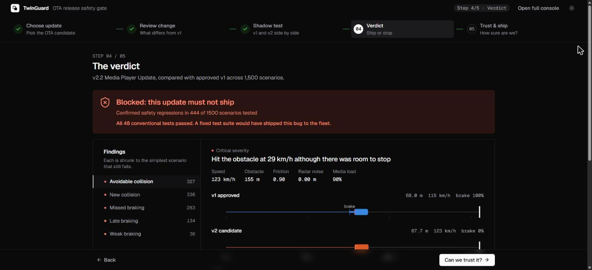
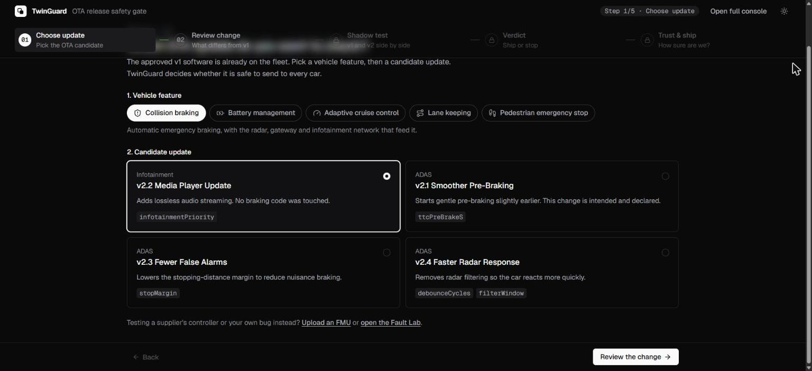
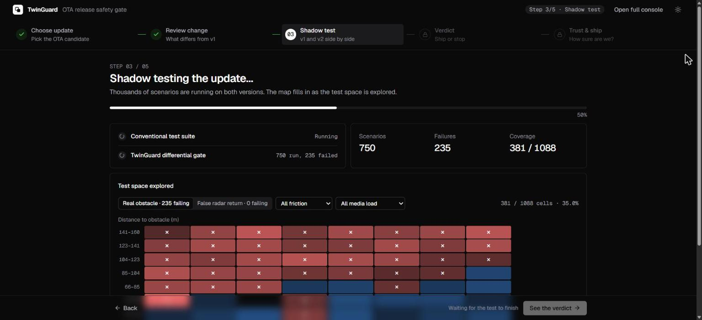
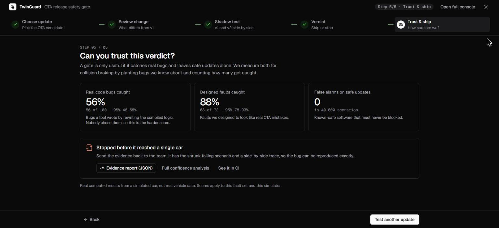

# TwinGuard

**A safety gate for over-the-air (OTA) car updates. It runs the new software side by side with the approved software in a simulated car, blocks updates that make the car less safe, and measures how far you can trust its own verdict.**

    



## The problem

An OTA update reaches thousands of cars at once. Today, an update ships when it passes a fixed test suite, but passing tests says nothing about whether those tests *could have caught the bug*.

**Example.** A media player update adds lossless audio. It changes no braking code, and it passes all 48 conventional tests. But it gives audio traffic the same network priority as radar and brake messages. Under heavy media load, radar data reaches the braking computer too late, and the car hits an obstacle that the approved software stops for.

TwinGuard catches this, and it tells you how often it catches bugs like it.

## How it works

1. **Shadow testing.** The approved software (v1) and the update (v2) drive the same simulated scenarios with the same sensor noise, so any difference comes from the update.
2. **Smart search.** It explores thousands of scenarios, focusing on near-misses and on the settings the update changed.
3. **Fixed safety rules.** Besides comparing v1 and v2, it applies rules that can never be waived, such as "no avoidable collision". An update can declare intended changes in a manifest, but it can't waive a safety rule.
4. **Confirm and shrink.** A failure must repeat on more than one noise seed. It is then shrunk to the simplest scenario that still fails, with a side-by-side replay.
5. **Measured trust.** TwinGuard plants known bugs and counts how many it catches. Some it designs, and others a tool writes by rewriting the compiled code. It also runs known-safe software to count false alarms.

## The guided check

The app walks you through one release decision in five steps. Each step unlocks when the one before it is done.

| | |
|---|---|
|  **1. Choose update.** Pick a vehicle feature and an OTA candidate. |  **3. Shadow test.** Live progress, and a coverage map that fills in as failures are found. |
|  **4. Verdict.** Blocked or approved, with each finding shrunk and replayed. |  **5. Trust and ship.** How many real bugs this gate catches, and the evidence report. |

Step 2 shows exactly what the update changes compared with v1. Everything else, including uploading your own FMU and the Fault Lab where you write your own bug, is in the full console.

## Results

Measured live each time the app starts. These are real computed results from a simulated car.

| Feature | Real code bugs caught | Random testing, same budget | Designed faults caught | False alarms |
|---|---|---|---|---|
| Collision braking | 56 of 100 (56%) | 57 of 100 | 63 of 72 | 0 in 40,000 scenarios |
| Battery management | 31 of 50 (62%) | 30 of 50 | 23 of 28 | 0 in 16,000 |
| Adaptive cruise control | 46 of 64 (72%) | 45 of 64 | 22 of 26 | 0 in 16,000 |
| Lane keeping | 20 of 30 (67%) | 20 of 30 | 21 of 25 | 0 in 16,000 |
| Pedestrian emergency stop | 50 of 70 (71%) | 50 of 70 | 26 of 28 | 0 in 16,000 |
| **Total** | **203 of 314 (65%)** | **202 of 314** | **155 of 179 (87%)** | **0 in 104,000** |

- **Real code bugs** are mutants: a tool rewrites the compiled logic, for example turning `<` into `<=`. Nobody chose them and nothing was tuned against them, so this is the harder, more honest score. **Designed faults** were chosen by us.
- **Search doesn't beat random testing at this budget.** Change-aware search finds braking bugs *sooner*, which matters when each test is expensive, as on a hardware rig. It doesn't find *more* of them.
- **Higher fidelity.** 12 braking failures were replayed on the CARLA simulator: 9 reproduced, 1 was inconclusive, and 2 showed a different failure.
- **Third-party code.** A braking controller written in C and packaged as an FMU behaved identically to the Java version across 3,000 scenarios.

## Calibrated against real data

Two of the five models are fitted to public recordings of real vehicles and cells. Error is measured on data held back from fitting. See [CALIBRATION.md](CALIBRATION.md) for the method and limits.

| Model | Data | Before | After |
|---|---|---|---|
| Adaptive cruise control | [OpenACC](https://data.jrc.ec.europa.eu/dataset/9702c950-c80f-4d2f-982f-44d06ea0009f) (EU JRC): five production cars on ACC on a test track | 16.7 m gap error | **4.4 m** |
| Battery management | [NASA PCoE](https://phm-datasets.s3.amazonaws.com/NASA/5.+Battery+Data+Set.zip) Li-ion cell tests at 4 °C and 24 °C | 320 mV voltage error | **72 mV** |

Calibration exposed real problems. The original battery settings couldn't charge a real cell past 88%, and broke the 4.25 V limit themselves near freezing. The data also shows string instability in production ACC: each car down a platoon brakes harder, at 1.9, 2.6, 3.2 and 4.3 m/s². Collision braking, lane keeping and pedestrian stop are still uncalibrated.

## Five vehicle features

| Feature | Fixed safety rules |
|---|---|
| **Collision braking** | No avoidable collision and no phantom braking. Includes the radar, gateway network and infotainment traffic, a replay, and a CARLA re-check |
| **Battery management** | Cell voltage at most 4.25 V, temperature at most 60 °C, no fast charging below 0 °C, no overcharging |
| **Adaptive cruise control** | No avoidable collision, never above the set speed |
| **Lane keeping** | Stay in lane where the tyres can hold the curve, and no steering with nothing to correct |
| **Pedestrian emergency stop** | No avoidable hit and no false stops. Detection is simulated, with no camera |

Adding a feature means implementing `VehicleFeature` (scenarios, physics, software and rules) and listing it in `Features.java`. The engine supplies search, coverage, confirmation, shrinking, scoring and the API.

## Quick start

Requires Java 17+, Maven and Node.

```powershell
powershell -ExecutionPolicy Bypass -File .\start.ps1 -Rebuild
```

Open **http://127.0.0.1:8787**. Scores are measured at startup, which takes about a minute, and the app is usable meanwhile.

For frontend work, run the backend, then `npm run dev` in `frontend/` and open http://localhost:5173.

Optional:
- **CARLA re-check:** see [carla_bridge/README.md](carla_bridge/README.md).
- **Your own FMUs:** see [fmus/README.md](fmus/README.md). Rebuilding the example FMUs needs [Zig](https://ziglang.org).
- **Recalibrate:** see [CALIBRATION.md](CALIBRATION.md). The datasets (about 307 MB) download with `scripts/fetch_public_data.sh`.

## In CI

The same gate runs from the command line, with exit codes for a pipeline: `0` approve, `1` block, `2` needs review, `3` bad usage.

```powershell
java -jar backend\target\twinguard.jar gate --release=v2.2-media --report=gate-report.json --html=gate-report.html
java -jar backend\target\twinguard.jar campaign --report=campaign.json --min-score=70
java -jar backend\target\twinguard.jar mutation --report=mutation.json
java -jar backend\target\twinguard.jar feature --id=battery --release=bms-1.3-winter --report=battery.json
java -jar backend\target\twinguard.jar gate --fmu-baseline=fmus\brake_v1_supplier.fmu --fmu-candidate=fmus\brake_v2_radar_bug.fmu
java -jar backend\target\twinguard.jar gate --release=v2.2-media --recheck=carla --recheck-report=recheck.json
```

A GitHub Actions workflow in `.github/workflows/twinguard-gate.yml` runs the tests, both score campaigns and the gate, and keeps the JSON and HTML evidence.

Demo braking releases: `v2.1-comfort` (safe, declared), `v2.2-media`, `v2.3-nuisance` and `v2.4-fast-radar`.

## What the brief asked, and our answer

| Brief asks | TwinGuard's answer |
|---|---|
| **Test environment** | A mocked vehicle: sensor ECU, gateway with priority queues, braking ECU, brake actuator, infotainment traffic, and vehicle physics |
| **Test generation** | Varies speed, distance, friction, sensor noise and infotainment load, including false radar returns |
| **Prioritisation** | Favours near-collision scenarios, and scenarios linked to the settings v2 changed |
| **Coverage** | A 1,088-cell map across speed, distance, friction and load, plus false-return scenarios |
| **Detection** | Compares v2 with v1, and applies fixed safety rules. Findings must repeat on 2 of 3 noise seeds |
| **Confidence** | 179 designed faults with a held-out subset, 314 real code mutants across the five features, Wilson 95% ranges, a random-testing baseline, and known-safe controls for false alarms |
| **Higher fidelity** | Failures replay on CARLA through a pluggable simulator interface. Two models are calibrated against recorded data |
| **Debugging** | Each failure is shrunk to its simplest form, with a side-by-side replay |
| **Release integration** | A command-line gate with exit codes, JSON and HTML evidence, and a GitHub Actions workflow |

## Limitations

TwinGuard is a fast filter before hardware-in-the-loop testing, not a replacement for it. An approval is evidence, not proof of safety, and is not certification against ISO 26262 or UN R156.

It does not model:
- Camera or radar perception. Sensors are values plus noise
- Real ECU timing, CAN electrical faults or hardware failures
- Moving obstacles and cut-ins in the braking feature, or real battery chemistry
- Combined faults. Each fault is injected alone
- Changes inside the tolerances, such as a 5% threshold shift

Three of the five models are uncalibrated, and the two calibrated ones only cover the conditions their data covers. Scores apply to this fault set and this simulator. The held-out faults aren't a formally blind test, because the generator was revised while their results were visible.

## Project layout

```text
backend/src/main/java/com/twinguard/
  feature/      Plugin system, plus the battery, cruise, lane and pedestrian features
  calibration/  Fitting models to recorded data (OpenACC loader, cruise fit, BMS re-tune)
  sim/          Vehicle, sensor, gateway and braking simulation, with a pluggable plant
  mutation/     Rewrites compiled logic into real bugs, and scores the gate on them
  testgen/      Scenario search, coverage map, shrinking, conventional suite
  oracle/       Safety rules and repeat-seed confirmation
  gate/         Release decision and evidence report
  campaign/     Fault-injection measurement
  fmu/          Loads and runs third-party FMI 2.0 FMUs
  carla/        Connects to CARLA through the bridge
  catalog/      Designed faults, demo releases, Fault Lab settings
  api/  cli/    REST and live-streaming API, CI command line, HTML report
backend/src/main/resources/calibration/   Fitted values (cruise.json, battery.json)
frontend/src/   React app: the guided check and the full console
carla_bridge/   Python bridge to a CARLA server, with a clearly labelled test double
fmus/           Example FMUs and their C source
scripts/        Dataset download and battery calibration
docs/           Screenshots
```

## Documents

- [DEMO.md](DEMO.md): the 4-minute presentation script and likely judge questions
- [CALIBRATION.md](CALIBRATION.md): data, method, results and limits of the calibration
- [fmus/README.md](fmus/README.md): testing your own FMUs
- [carla_bridge/README.md](carla_bridge/README.md): the CARLA re-check

## Data credits

- **OpenACC** © European Union, 1995–2026, licensed [CC BY 4.0](https://creativecommons.org/licenses/by/4.0/). Makridis et al. (2021), *OpenACC. An open database of car-following experiments to study the properties of commercial ACC systems*, Transportation Research Part C 125. Used to fit the cruise control model.
- **NASA PCoE Battery Data Set**, B. Saha and K. Goebel (2007), NASA Prognostics Data Repository, NASA Ames Research Center. US government work. Used to fit the battery model.

The datasets are not stored in this repository. `scripts/fetch_public_data.sh` downloads them.
